Theo như tôi nghiên cứu, các mô hình hiện tại đối với spaced repetition, điển hình là Anki, hầu hết đều giả định các mục cần nhớ là những flashcard độc lập. Cách này phù hợp với việc học từ vựng ngoại ngữ hay dữ kiện rời rạc, nơi việc nhớ từ này hầu như không phụ thuộc hay củng cố trực tiếp cho từ kia, ý tưởng là chỉ cần đảm bảo input đủ nhiều sẽ cải thiện vốn từ vựng ngoại ngữ.

Ngược lại, đối với các hệ thống tri thức yêu cầu cấu trúc phân cấp và liên kết chặt chẽ, mô hình này lại nảy sinh một điểm yếu. Thoạt nhìn bạn có thể nghĩ chỉ cần điều chỉnh đơn giản vài thứ cho bộ thẻ flash card là được:

- Đầu tiên, *thay thế các thẻ flashcard bằng các dạng bài tập*. Mỗi thẻ đại diện cho 1 chủ đề (như nghịch đảo ma trận). Sau đó khi bạn ôn, nó sẽ chọn ngẫu nhiên 1 bài toán từ ngân hàng câu hỏi của chủ đề đó. Nếu bạn giải đúng, sẽ được coi là "đã nhớ".
- Thêm nữa, phải đảm bảo được cái gọi là prerequisite relationships: chỉ mở khóa một chủ đề mới khi đảm bảo bạn đã nắm vững toàn bộ các chủ đề tiên quyết của nó.

Nhìn qua có vẻ đây là 1 cách tiếp cận dễ dàng, thế nhưng "the devil is in the details". Cấu trúc phân cấp làm phát sinh các vấn đề phức tạp trong việc mô hình hóa. Chẳng hạn, việc giải một bài toán nâng cao thực chất đã rèn luyện ngầm các kỹ năng cơ bản cấu thành nên nó, lẽ ra lịch ôn tập của các kỹ năng cơ bản này phải được đẩy lùi tương ứng (trickle-down credit), đồng thời kết hợp với việc chiết khấu hợp lý.

May mắn thay, Justin Skycak có gợi ý cho ta 1 kỹ thuật thú vị gọi là **Hierarchical Spaced Repetition (HSRS)** dựa trên 2 cơ chế cốt lõi là **Fractional Implicit Repetition (FIRe)** và **Spaced Repetition Compression**. Mặc dù thuật toán này không được open source, nhưng những ý tưởng high-level cho phép chúng ta nắm bắt được nguyên lý và tái tạo lại thuật toán.

## Spaced Repetition Compression

Ví dụ với toán học, khi giải một bài toán nâng cao, buộc người học phải thực hiện nhiều kỹ năng cơ bản hơn ở các bước trung gian để giải bài toán đó. Tức là, các chủ đề nâng cao sẽ **encompass** các chủ đề cơ bản đó. Cũng cần phân biệt encompass và prerequisite, chủ đề A là tiên quyết của B nếu cần học A trước để hiểu B, nhưng A chỉ được B bao hàm khi việc giải bài tập B trực tiếp bắt người học thực hành lại kỹ năng giải bài tập A (chẳng hạn, tìm nghịch đảo ma trận 3 × 3 bằng phần bù bao hàm trực tiếp việc tính định thức cấp 2).

Bằng cách này, khi nhiều chủ đề cũng đến hạn ôn tập, người học không cần giải từng chủ đề một. Thay vào đó, thuật toán sẽ gom và nén danh sách đến hạn thành một tập hợp nhỏ các chủ đề bậc cao có khả năng bao phủ ngầm các chủ đề cơ bản bên dưới. Thậm chí nó cho phép chúng ta chọn ra những lộ trình học tập giúp tối thiểu hóa việc ôn tập, vừa giảm nhẹ gánh nặng học tập vừa thúc đẩy ta chinh phục những kiến thức mới. Quá trình này được gọi là **Spaced Repetition Compression**.

Để minh hoạ, ta sẽ thử xét bài toán sau, tìm nghịch đảo của

$$
A = \begin{pmatrix}
1 & 2 & 0 \\
3 & 1 & 2 \\
0 & 1 & 1
\end{pmatrix}
$$

bằng phương pháp phần bù, $A^{-1}=\frac{1}{\det A}\operatorname{adj}(A)$.

Để giải bài toán trên, ta phải thực hiện 4 kỹ năng gồm tìm định thức cấp 2, cấp 3, chuyển vị và nhân ma trận. 
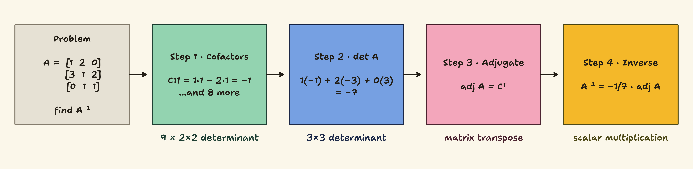

Nói cách khác, chủ đề *Nghịch đảo ma trận 3x3* **bao hàm** *Tính định thức ma trận 2x2*, *Tính định thức ma trận 3x3*, *Chuyển vị ma trận* và *Nhân ma trận với một số bất kỳ*. Từ đây ta có thể trực quan hóa mối quan hệ này bằng một *đồ thị bao hàm* (encompassing graph) như sau:

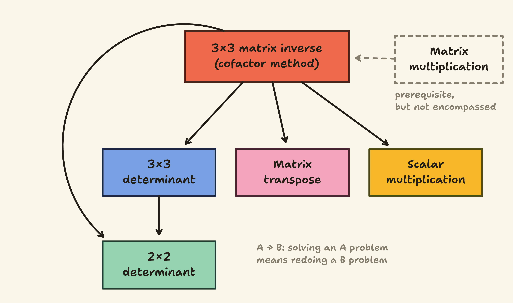

Bây giờ, giả sử hôm nay người học đến hạn ôn tập cả 5 chủ đề này. Nếu thiết kế chúng như các flashcard độc lập, người học phải giải 5 bài toán khác nhau. Nhờ có các mối quan hệ bao hàm này, bài tập duy nhất mà người học đó thực sự cần làm là **Nghịch đảo ma trận 3x3**. Khi hoàn thành bài tập này, 4 chủ đề còn lại đều sẽ nhận một lần lặp lại ngầm (implicit repetition), và lịch ôn tập sẽ được đẩy lùi tương ứng, bởi vì về bản chất, học sinh đã ôn tập cả những kỹ năng đó rồi.
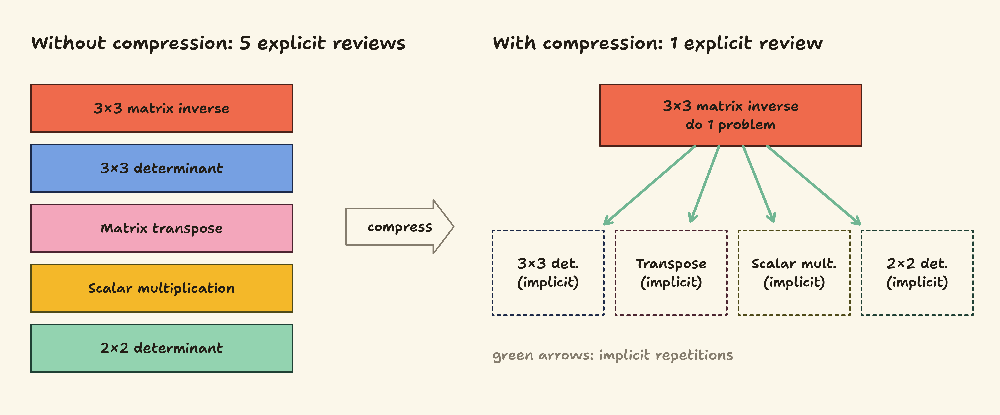

Khối lượng ôn tập thực tế là không giảm, thứ thực sự giảm là số lượng bài tập người học phải làm riêng cho mỗi chủ đề. Nhìn chung, càng có nhiều mối quan hệ bao hàm, số lượng các *explicit reviews* thực sự cần làm sẽ ít đi. Một chủ đề càng nằm sâu trong đồ thị, thì sẽ có càng nhiều chủ đề phía trên bao hàm nó, và càng ít khi phải ôn tập. Và toán học thì có rất nhiều mối quan hệ bao hàm.

Cũng cần lưu ý rằng, **Spaced Repetition Compression** còn hơn cả chỉ là giảm thiểu số lượng bài tập đến hạn, bởi vì nó cho phép ta thiết kế các lộ trình nhằm tối thiểu hóa cả các *explicit reviews*.

Cơ chế này vận hành ở 2 trạng thái: khi có bài tập đến hạn, thuật toán sẽ gom chúng về thành một vài chủ đề bậc cao; khi không còn bài tập nào đến hạn, thuật toán sẽ chọn các chủ đề mới giúp đẩy lùi lịch ôn tập sắp tới của các nhánh bên dưới, đồng thời mở rộng đồng đều trên đồ thị để duy trì nhiều hướng nén cho các vòng sau.

Mức độ cắt giảm *explicit reviews* sẽ phụ thuộc vào mật độ các cạnh của *encompassing graph*, nằm giữa hai vùng biên:
- **Mật độ bao hàm bằng 0 (biên dưới)**: Các chủ đề hoàn toàn rời rạc như các thẻ flashcard, tức là 1 tập hợp các chủ đề không có mối quan hệ bao hàm nào. Trong bối cảnh này, không chủ đề nào cung cấp các lần lặp lại ngầm cho bất kỳ chủ đề nào khác, từng bài ôn tập một đều phải được thực hiện một cách tường minh. Ở một quy mô vài trăm chủ đề như thế, số lượng bài ôn sẽ cộng dồn thành một con số khủng khiếp, làm nghẽn tiến độ học tập và tăng khả năng từ bỏ của người học. Trong spaced repetition, nó được gọi là **hiệu suất học tập tối thiểu theo lý thuyết (theoretical minimum learning efficiency)**.
- **Mật độ bao hàm toàn phần (biên trên)**: Ngược lại, cũng có khái niệm về **hiệu suất học tập tối đa theo lý thuyết** (**theoretical maximum learning efficiency**). Về mặt lý thuyết, nếu có một hệ thống tri thức với mật độ bao hàm đủ lớn, bạn hoàn toàn có thể hoàn thành mọi chu kỳ *spaced repetition* của mình mà không bao giờ phải ôn tập tường minh lại các kiến thức đã học trước đó. Chủ đề sau sẽ bao hàm trọn vẹn các chủ đề ngay trước nó. Chừng nào người học vẫn tiếp tục học các chủ đề mới, mỗi bài học mới đều cung cấp đủ số lần lặp lại ngầm cho toàn bộ chuỗi bên dưới, số *explicit reviews* giảm về 0.

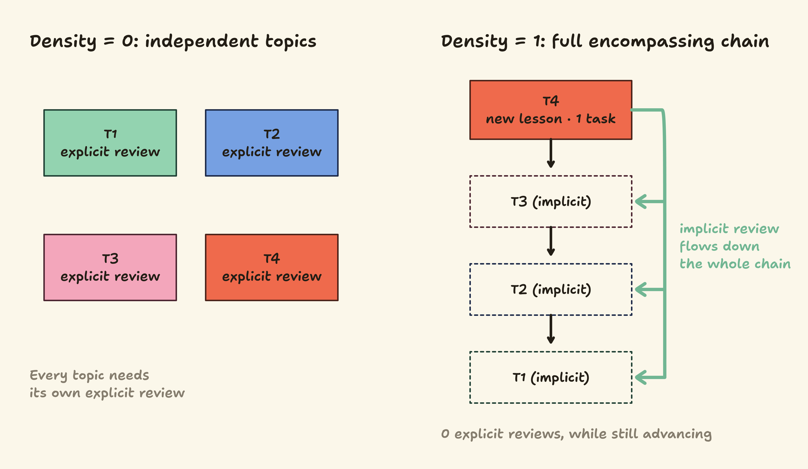

Điều quan trọng cần nhận ra là *một đồ thị không nhất thiết phải được bao hàm hoàn toàn, hay thậm chí gần như bao hàm hoàn toàn, thì hiệu suất học tập tối đa của nó mới tiệm cận được giới hạn lý thuyết.* Ngay cả khi phần lớn các mối quan hệ giữa các chủ đề không mang tính bao hàm, chỉ cần một tỷ lệ thiểu số đáng kể các mối quan hệ bao hàm cũng đã tạo ra tác động vô cùng lớn.

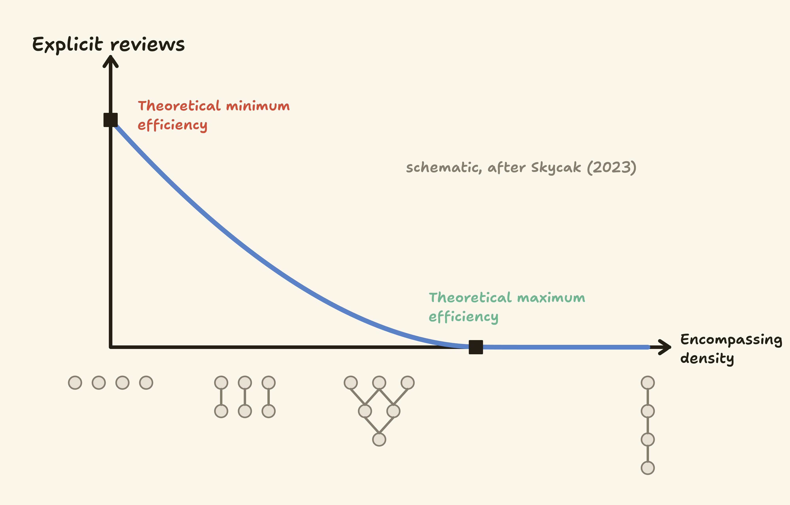

## Fractional Implicit Repetition (FIRe)

Sau khi đã giới thiệu về **Spaced Repetition Compression**, ta cần mở rộng sang ý tưởng tổng quát về **Lặp lại ngầm định phân số — Fractional Implicit Repetitions (FIRe)** chảy xuyên qua một *encompassing graph* theo 2 nguyên lý:
- các lần lặp lại trên những chủ đề nâng cao sẽ "chảy ngược xuống" (*trickle down*) một cách ngầm định tới các chủ đề đơn giản hơn thông qua các mối quan hệ bao hàm, và
- các chủ đề đơn giản hơn khi nhận được nhiều lần lặp lại ngầm định sẽ chiết khấu (*discount*) các lần lặp lại đó một cách thích hợp (bởi vì chúng thường diễn ra sớm hơn kỳ hạn ôn tập).

### Lan truyền hai chiều qua nhiều tầng

Quay lại bài toán **Nghịch đảo ma trận $3\times 3$**. Nếu bạn vượt qua bài tập ở chủ đề này, thì hệ thống sẽ trickle down để thưởng cho toàn bộ các kỹ năng thành phần: không dừng ở 3 nút liền kề (*Tính định thức $3\times 3$*, *Chuyển vị*, *Nhân ma trận với một số*, nó còn truyền tiếp sang tầng thứ hai xuống *Tính định thức $2\times 2$*, vì để giải đúng bài toán gốc bạn vẫn phải thực hiện trơn tru toàn bộ chuỗi bước trung gian.  
Mặt khác, nếu bạn làm sai ở một kỹ năng nền. Giả sử bạn làm sai *Tính định thức $2\times 2$*: một khi bước tính định thức cấp 2 đã hỏng, bạn khó có thể tính đúng định thức cấp 3 hay nghịch đảo ma trận cấp 3 bằng phần bù. Điểm phạt khi đó lan truyền ngược từ dưới lên để kéo lùi lịch ôn của *Tính định thức $3\times 3$* và *Nghịch đảo ma trận $3\times 3$*, trong khi hai nhánh không chứa kỹ năng này là *Chuyển vị* và *Nhân ma trận với một số* vẫn giữ nguyên lịch trình.

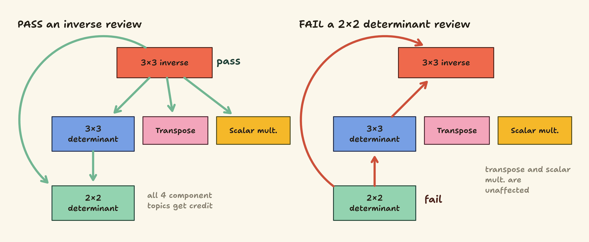

Trên một đồ thị nhiều tầng, cơ chế này có thể mở rộng đệ quy đến các nút bậc 2, bậc 3 và xa hơn: một lần vượt qua ở chủ đề nâng cao truyền dòng tín dụng hướng xuống các nhánh con cháu bên dưới, còn một lần trượt ở chủ đề cơ bản đẩy dòng phạt tỏa ngược lên mọi chủ đề tổ tiên bao hàm nó.

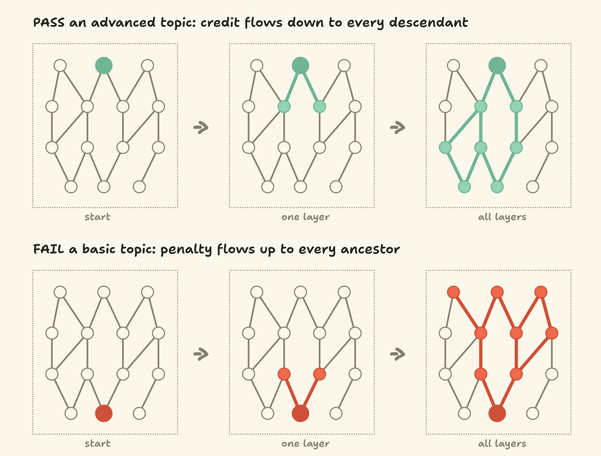

### Partial Encompassings

*FIRe* cũng xử lý tự nhiên các trường hợp **bao hàm một phần** (**partial encompassings**), trong đó chỉ một phần nào đó của chủ đề đơn giản hơn được luyện tập ngầm định trong chủ đề nâng cao. Điều này xuất hiện thường xuyên ở toán học bậc cao.

Ví dụ, trong giải tích, với chủ đề *Tích phân từng phần* ($\int u\,dv$): mỗi bài toán ngẫu nhiên trong ngân hàng câu hỏi đều rèn luyện quy tắc biến đổi từng phần, nhưng chỉ một phần số bài đòi hỏi tính nguyên hàm của hàm mũ, một phần khác rơi vào hàm lượng giác hoặc đa thức. Việc hoàn thành một bài tập tích phân từng phần vì thế chỉ cung cấp một phần phân số (*fraction*) của lần lặp lại cho từng họ nguyên hàm cơ bản kia.

Bên cạnh đó, ta gán cho các mối quan hệ bao hàm bằng một trọng số (weights) nhằm biểu thị tỷ lệ phần trăm mà mỗi chủ đề đơn giản hơn được luyện tập trong quá trình làm chủ đề nâng cao hơn. Nôm na là, các trọng số này đại diện cho xác suất một bài toán ngẫu nhiên của chủ đề A buộc người học thực hành kỹ năng của chủ đề B.
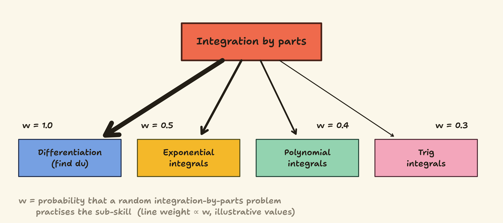

*FIRe* sẽ mở rộng dòng chảy lặp lại sâu qua nhiều tầng thông qua các mối quan hệ bao hàm phân số (*fractional encompassings*). Kết quả cuối cùng là các lần lặp lại sẽ:

1. truyền đi không bị cản trở dọc theo một "thân chính" (*trunk*) gồm các mối quan hệ bao hàm toàn phần, và
2. mờ dần dọc theo các mối quan hệ bao hàm một phần (*partial encompassings*) rẽ nhánh ra bên ngoài từ thân chính đó.
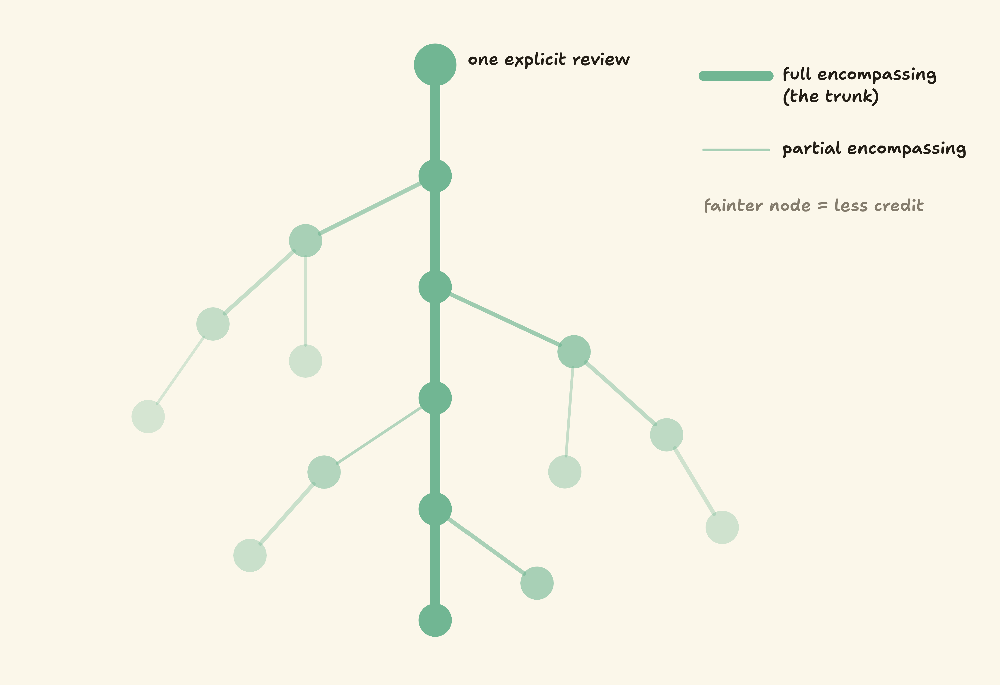

### Thiết lập trọng số bao hàm

Vì các trọng số bao hàm (*encompassing weights*) được khuyến khích thiết lập bởi chuyên gia trong lĩnh vực, việc gán trọng số tường minh cho từng cặp chủ đề trong đồ thị là điều bất khả thi khi mở rộng hệ thống: với hàng nghìn chủ đề, ma trận trọng số sẽ chứa tới hàng chục triệu phần tử. Làm sao để ta thiết lập hết từng ấy trọng số được?

Hóa ra, việc này có lẽ đơn giản hơn những gì ta lo lắng, ta không cần phải gán trọng số cho toàn bộ, mà chỉ cần thỏa mãn 3 điều kiện sau:
1. **Trọng số có độ lớn đáng kể:** Để một lần ôn tập tạo ra được tác động trong việc đẩy lùi các *explicit reviews* ta cần một lượng credit đủ lớn.
2. **Chưa được suy diễn qua các đường đi trung gian**: Nếu tín dụng từ A truyền qua B xuống C đã phản ánh đúng mức độ A rèn luyện C (ví dụ máy tự nhân $w_{AB} · w_{BC}$), chuyên gia không cần khai báo lại cạnh tắt A → C — chỉ cần nhập tay cạnh A → C khi phép nhân bắc cầu đó tính thiếu hoặc thừa so với thực tế đề bài của A.
3. **Khoảng cách giữa hai chủ đề trong *prerequisite graph* ngắn**: Nếu hai chủ đề nằm cách nhau quá nhiều tầng tiên quyết, đến thời điểm người học chạm tới chủ đề nâng cao thì chủ đề cơ bản vốn đã hoàn tất hầu hết các chu kỳ ôn tường minh từ trước; việc gán thêm cạnh bao hàm xa như vậy hầu như không giảm thêm số lần ôn.

Theo Justin Skycak, những trọng số thỏa mãn các điều kiện nêu trên thường nằm dọc theo các cạnh điều kiện tiên quyết trực tiếp và cốt lõi, mà số lượng các cạnh này chỉ tăng tuyến tính theo số lượng chủ đề. Tức là $O(N)$ thay vì $O(N^2)$.

## Hiệu chỉnh theo từng học sinh và từng chủ đề

Tốc độ học tập (và ghi nhớ những gì đã học) là khác nhau ở mỗi học sinh. Các nghiên cứu đã chỉ ra rằng một số học sinh học nhanh hơn và nhớ lâu hơn, trong khi những học sinh khác lại học chậm hơn và quên nhanh hơn. Tương tự, tốc độ học tập cũng khác nhau giữa các chủ đề: những chủ đề dễ hơn sẽ được học nhanh hơn và nhớ lâu hơn, trong khi những chủ đề khó hơn sẽ tốn nhiều thời gian học hơn và bị quên nhanh hơn.

Do đó, đối với mỗi học sinh, mỗi chủ đề có một *learning speed* phụ thuộc vào *student's ability* và *topic's difficulty*. 2 yếu tố này bản chất là đối nghịch nhau: năng lực của người học tăng tốc độ học tập, còn độ khó của chủ đề lại làm nó chậm lại. Dưới góc nhìn này, nó sẽ được biểu diễn như sau:
$$\text{student-topic learning speed} = \frac{\text{speedup due to student ability}}{\text{slowdown due to topic difficulty}}$$

Các giá trị *speed* được sử dụng để điều chỉnh tốc độ của quá trình ôn tập ngắt quãng.
- Chẳng hạn, nếu một học sinh làm bài tập ở một chủ đề mà *learning speed* của em đó đạt $2\times$, thì bài ôn tập đó được tính giá trị tương đương 2 lần *spaced repetitions*.
- Tương tự, nếu một học sinh làm bài tập ở một chủ đề mà *learning speed* của em đó là $0.5\times$, thì bài ôn tập đó chỉ được tính giá trị bằng 0.5 lần *spaced repetition*.

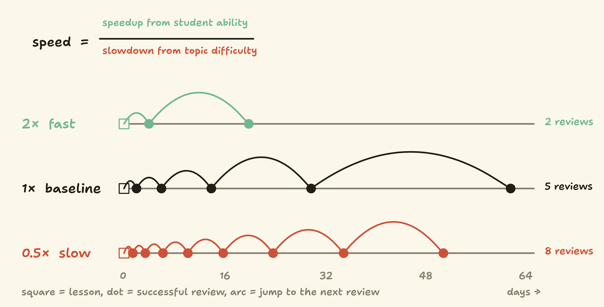

*Student-topic learning speeds* cũng được đưa vào tính toán bên trong *Fractional Implicit Repetition (FIRe)*. Những người có khả năng học tập yếu hơn thường gặp khó khăn trong việc giải quyết các bài tập ở những chủ đề khó – họ sẽ khó khái quát hóa được rằng "những gì mình học trước đây chính là một trường hợp đặc biệt (hoặc một thành phần) của những gì mình đang học bây giờ.

Vì thế, bất cứ khi nào một chủ đề có $\text{speed} < 1$, tốt nhất là nên hủy bỏ toàn bộ điểm tín dụng lặp lại ngầm định truyền tới và thay vào đó bắt buộc thực hiện ôn tập tường minh. 

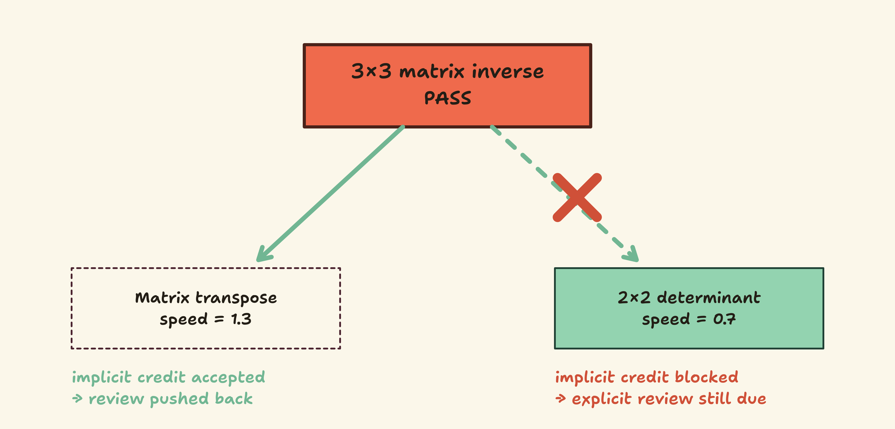

Việc quyết định có bắt buộc ôn tập tường minh hay không dựa trên *student-topic learning speed* là hoàn toàn hợp lý, bởi vì khi tiến trình *spaced repetition* của một chủ đề bị làm chậm lại, điều đó cho thấy chủ đề này được xem là khá khó so với năng lực hiện tại của học sinh đó.

## Cấu trúc tổng quát của mô hình Hierarchical Spaced Repetition

Ở mức tổng quát, toàn bộ các cơ chế từ *FIRe* đến cá nhân hóa tốc độ học hội tụ vào việc cập nhật hai biến trạng thái cho mỗi cặp *(student, topic)*:

$$\begin{aligned} \text{repNum} &\leftarrow \max\!\left(0,\; \text{repNum} + \text{speed} \cdot \text{decay}^{\text{failed}} \cdot \text{rawDelta}\right) \\ \text{memory} &\leftarrow \max\!\left(0,\; \text{memory} + \text{rawDelta}\right)  (0.5)^{\text{days} / \text{interval}} \end{aligned}$$

Cách các đại lượng trong hệ phương trình này kết hợp với nhau có thể chia thành ba cụm:
- **Sự suy giảm trí nhớ theo thời gian ($\text{repNum}$, $\text{interval}$, $\text{days}$, $\text{memory}$):** 
	- $\text{repNum}$ là số vòng *spaced repetition* thành công mà người học đã tích lũy trên một chủ đề cụ thể; từ $\text{repNum}$ ta sẽ xác định được số ngày giãn cách lý tưởng $\text{interval}$ đến kỳ ôn thứ $\text{repNum} + 1$, còn $\text{days}$ là số ngày đã trôi qua kể từ lần lặp gần nhất. 
	- $\text{memory}$ là mức độ ghi nhớ kỳ vọng của người học ở thời điểm hiện tại. Biết rằng $\text{memory}$ suy giảm theo thời gian và theo hàm mũ cơ số $0.5$ (cứ sau $\text{interval}$ ngày lại giảm đi một nửa). Và lần ôn tập lặp lại kế tiếp sẽ đến hạn khi $\text{memory}$ giảm xuống đủ thấp, nếu lúc đó không có chủ đề nào phù hợp để nén ngầm định ngay, hệ thống sẽ giao trực tiếp một *explicit review* thay vì trì hoãn.
- **Tín dụng thô và chiết khấu khi ôn sớm ($\text{rawDelta}$):**
	- $\text{rawDelta}$ là lượng điểm tín dụng thô mà người học nhận được trong lần ôn tập lặp lại đó, chưa xét đến $\text{speed}$ và $\text{decay}$. $\text{rawDelta}$ mang dấu dương nếu vượt qua và dấu âm nếu làm sai (độ lớn phụ thuộc chất lượng bài làm). Giá trị này đến từ cả bài ôn tập trực tiếp lẫn từ cơ chế lan truyền của *FIRe* (tín dụng dương chảy từ chủ đề bậc cao xuống, hoặc tín dụng âm từ chủ đề cơ bản dội ngược lên). 
	- Nếu một lần lặp (đặc biệt là lặp ngầm định) diễn ra quá sớm so với $\text{interval}$ mong muốn, tức khi $\text{memory}$ hiện tại vẫn còn cao, giá trị của $\text{rawDelta}$ sẽ bị chiết khấu giảm xuống để tránh đẩy $\text{repNum}$ tăng ảo khi người học làm liên tiếp nhiều chủ đề nâng cao trong thời gian ngắn.
- **Điều chỉnh bước nhảy và phạt quá hạn ($\text{speed}$, $\text{failed}$, $\text{decay}$):**
	- $\text{failed}$ nhận giá trị $0$ khi vượt qua (passed) và $1$ khi trượt (failed). Nếu vượt qua ($\text{decay}^0 = 1$), $\text{repNum}$ tiến thêm một lượng bằng $\text{speed} \cdot \text{rawDelta}$. Nếu trượt ($\text{failed} = 1$, $\text{rawDelta} < 0$), mức lùi của $\text{repNum}$ sẽ bị khuếch đại thêm bởi hệ số $\text{decay}$ $\ge 1$. 
	- $\text{decay}$ là tốc độ mà học sinh bị lùi lại trong quá trình spaced repetition, bắt đầu từ $1$ và tăng dần khi bài ôn tập bị quá hạn càng lâu so với $\text{interval}$ (tức $\text{memory}$ đã tụt sát $0$). $\text{decay}$ được dùng để mô hình hóa sự suy giảm kiến thức sau quãng nghỉ dài tương tự hiện tượng *summer slide* (hiện tượng suy giảm kiến thức của học sinh sau kỳ nghỉ hè dài).
	- Trong thực tế, nếu người học nghỉ gián đoạn hẳn vài tháng rồi mới quay lại, thay vì dồn toàn bộ các chủ đề quá hạn thành một danh sách ôn tập khổng lồ, tốt hơn hết là dùng một bài kiểm tra chẩn đoán để kéo lùi đường biên tri thức về đúng điểm có thể tiếp tục học trơn tru.

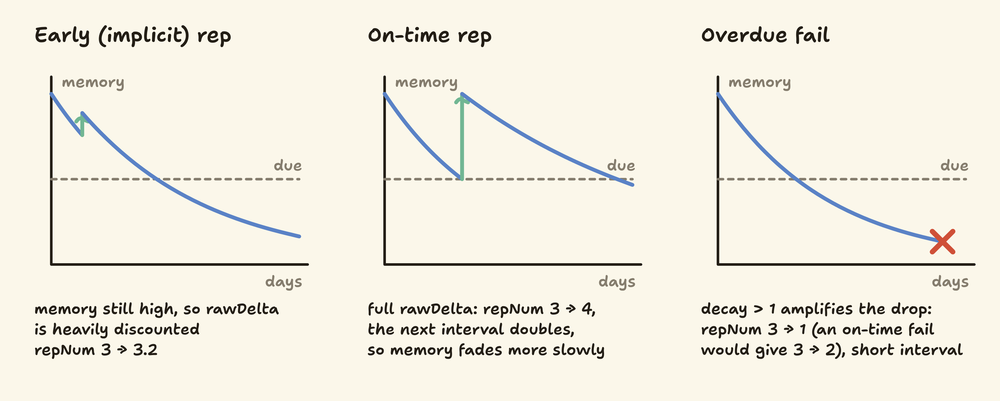

Nhìn tổng thể, bài toán theo dõi trạng thái trên đồ thị tri thức cũng có thể tiếp cận bằng các mô hình xác suất như *Bayesian Knowledge Tracing (BKT)*. Tuy nhiên, khi hệ thống phải xử lý đồng thời nhiều tầng quyết định: nén bài đến hạn, chọn bài học để đẩy lùi lịch ôn tương lai, chặn dòng lặp ngầm khi $\text{speed} < 1$, chiết khấu ôn sớm và phạt quá hạn; các mô hình cập nhật xác suất rất dễ bùng nổ độ phức tạp và khó kiểm soát. Việc mô hình hóa mỗi lượt làm bài như một dòng chảy tác động tường minh lên `(repNum, memory)` giúp HSRS giữ được cấu trúc đủ đơn giản để diễn giải, gỡ lỗi và mở rộng ổn định trên đồ thị hàng nghìn chủ đề.

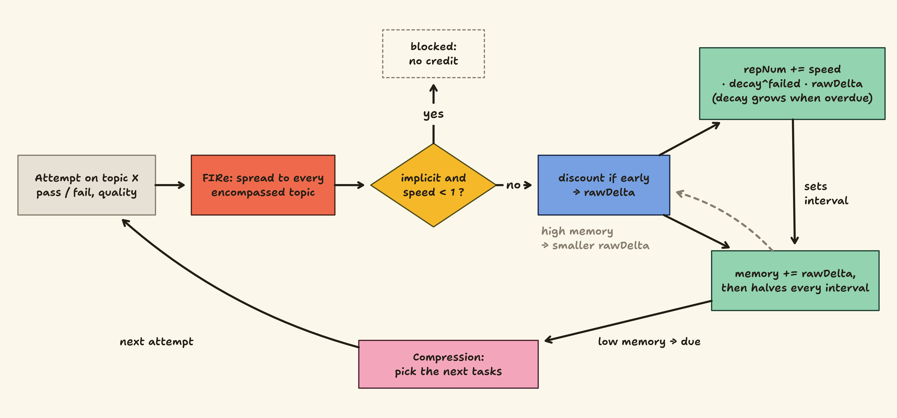
