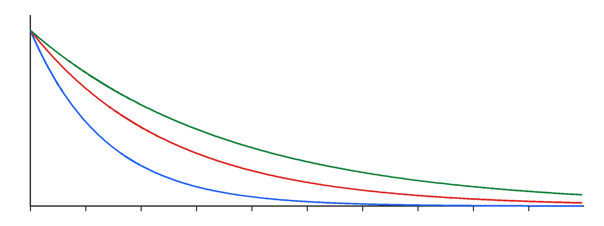

import duongQuen from './duong-quen.png';
import anhMau from './anh-mau.jpg';

Đoạn mở đầu có **chữ đậm**, *chữ nghiêng*, ***cả hai***, `mã nội dòng`, ~~gạch ngang~~, <mark>tô sáng</mark>, <kbd>Ctrl</kbd> + <kbd>K</kbd>, H<sub>2</sub>O, x<sup>2</sup>, một [liên kết nội bộ](/blog/dinh-ly-godel/), một [liên kết ra ngoài](https://example.com) và một chú thích.[^1] Thêm một từ không ngắt được: Donaudampfschifffahrtsgesellschaftskapitänswitwe, và một đường dẫn dài https://example.com/mot/duong/dan/rat/dai/khong/co/khoang/trang/nao/de/xuong/dong.

Đoạn thứ hai để soát khoảng cách giữa các đoạn văn. Hệ hình thức<Sidenote>Ghi chú bên lề viết ngay sau từ cần giải thích. Có thể chứa *nghiêng* và $\varphi$.</Sidenote> gồm bảng chữ cái, tiên đề và quy tắc suy luận. Một <Term original="Consistency">tính nhất quán</Term> và một <Term original="Unvollständigkeit" lang="de">tính bất toàn</Term>.

## Tiêu đề cấp hai có `mã` trong tiêu đề

Văn bản ngay dưới tiêu đề cấp hai.

### Tiêu đề cấp ba

Văn bản dưới tiêu đề cấp ba.

#### Tiêu đề cấp bốn

Văn bản dưới tiêu đề cấp bốn.

## Danh sách

- Mục một
- Mục hai có đoạn văn dài hơn một dòng để xem thụt lề khi xuống dòng, cần đủ dài để chắc chắn tràn qua dòng thứ hai trên mọi màn hình.
  - Mục lồng cấp hai
  - Mục lồng cấp hai với `mã`
    - Mục lồng cấp ba
- Mục ba

1. Bước một
2. Bước hai
   1. Bước con
   2. Bước con thứ hai
3. Bước ba
10. Số hai chữ số để thử canh lề số thứ tự

- [x] Việc đã xong
- [ ] Việc chưa xong

## Trích dẫn

> Trích dẫn Markdown thường, đủ dài để xuống dòng và xem thanh dọc bên trái kéo dài theo đoạn văn.
>
> > Trích dẫn lồng trong trích dẫn.

<PullQuote author="David Hilbert, Königsberg, 1930">Wir müssen wissen — wir werden wissen. Chúng ta phải biết, chúng ta sẽ biết.</PullQuote>

---

## Công thức

Công thức nội dòng $a^2 + b^2 = c^2$ và một công thức cao $\sum_{n=1}^{\infty} \frac{1}{n^2}$ trong dòng.

$$
\sum_{n=1}^{\infty} \frac{1}{n^2} = \frac{\pi^2}{6}
$$

Công thức riêng dòng rất dài để thử cuộn ngang:

$$
\operatorname{Prov}_S(\ulcorner \varphi \urcorner) \leftrightarrow \exists p \, \operatorname{Proof}_S(p, \ulcorner \varphi \urcorner) \quad \text{và} \quad S \vdash G \leftrightarrow \neg \operatorname{Prov}_S(\ulcorner G \urcorner) \quad \text{với mọi hệ } S \supseteq \mathsf{Q} \text{ nhất quán, đệ quy}
$$

## Code

```python
from sympy import prime

def godel_number(codes: list[int]) -> int:
    """Nén một dãy mã ký hiệu thành một số tự nhiên."""
    n = 1
    for i, c in enumerate(codes, start=1):
        n *= prime(i) ** c  # p_i ^ c_i
    return n
```

```ts
// Một dòng rất dài để thử cuộn ngang trong khối code: const veryLongVariableName = someFunction(argumentOne, argumentTwo, argumentThree);
export const answer: number = 42;
```

```
Khối code không khai báo ngôn ngữ.
```

## Bảng

| Mục tiêu        | Kết cục                  | Ai, khi nào            | Số |
| --------------- | ------------------------ | ---------------------- | -: |
| Nhất quán       | Không tự chứng minh được | Gödel, 1931            |  1 |
| Đầy đủ          | Bất khả                  | Gödel, 1931            | 12 |
| Quyết định được | Bất khả                  | Church và Turing, 1936 | 123 |

| Cột 1 | Cột 2 | Cột 3 | Cột 4 | Cột 5 | Cột 6 | Cột 7 | Cột 8 |
| ----- | ----- | ----- | ----- | ----- | ----- | ----- | ----- |
| Bảng rộng hơn cột chữ | để thử cuộn ngang | trên điện thoại | và màn hình hẹp | nội dung | nội dung | nội dung | nội dung |

## Ảnh

Ảnh Markdown, PNG nền trong suốt vẽ nét tối (giống các biểu đồ của bài HSRS):



<Figure src={duongQuen} alt="Ba đường cong quên" caption="Ảnh có chú thích qua thẻ Figure." credit="Ảnh: tự vẽ" />

<Figure src={anhMau} alt="Một dải màu" caption="Ảnh nền đặc, tỉ lệ 16:10." />

## Thẻ toán

<Definition title="Hệ hình thức">Một hệ hình thức $S$ gồm bảng chữ cái, tập tiên đề và quy tắc suy luận. Khi $\varphi$ có chứng minh trong $S$, ta viết $S \vdash \varphi$.</Definition>

<Axiom>Tiên đề không có tên.</Axiom>

<Theorem title="Bất toàn thứ nhất">Với mọi hệ hình thức $S$ nhất quán và đủ mạnh, tồn tại mệnh đề $G$ sao cho $S \nvdash G$ và $S \nvdash \neg G$.</Theorem>

<Proof>Giả sử $S \vdash G$. Khi đó $S \vdash \neg G$, mâu thuẫn với tính nhất quán.</Proof>

<Lemma title="Bổ đề chéo hóa">Với mọi công thức $\psi(x)$ có một biến tự do, tồn tại câu $\varphi$ sao cho $S \vdash \varphi \leftrightarrow \psi(\ulcorner \varphi \urcorner)$.</Lemma>

<Proposition>Mệnh đề không có tên.</Proposition>

<Corollary title="Bất toàn thứ hai">Hệ $S$ không chứng minh được tính nhất quán của chính nó.</Corollary>

<Example title="Số học Presburger">Hệ chỉ có phép cộng thì vừa nhất quán, vừa đầy đủ.</Example>

<Remark>

Nhận xét có nhiều đoạn.

Đoạn thứ hai của nhận xét.

</Remark>

<Proof label="Phác thảo chứng minh">

Chứng minh có nhãn riêng, nhiều đoạn.

Đoạn thứ hai của chứng minh.

</Proof>

## Hộp ghi chú

<Callout>Ghi chú mặc định, không có tiêu đề.</Callout>

<Callout type="warning" title="Cẩn thận khi trích dẫn">Định lý chỉ áp dụng cho hệ hình thức đủ mạnh, không áp dụng cho “mọi hệ thống” theo nghĩa rộng.</Callout>

<Callout type="idea" title="Ý tưởng">Hộp ý tưởng có `mã` và [liên kết](https://example.com).</Callout>

## Chú thích

Đoạn có chú thích thứ hai[^dai] và thứ ba.[^3] Dòng cuối của bài.

[^1]: Chú thích ngắn.
[^dai]: Chú thích dài nhiều câu để thử popover. Hội nghị Nhận thức luận các Khoa học Chính xác diễn ra tại Königsberg từ ngày 5 đến ngày 7 tháng 9 năm 1930, với $\omega$ trong chú thích và một [liên kết](https://example.com).
[^3]: Chú thích thứ ba.
